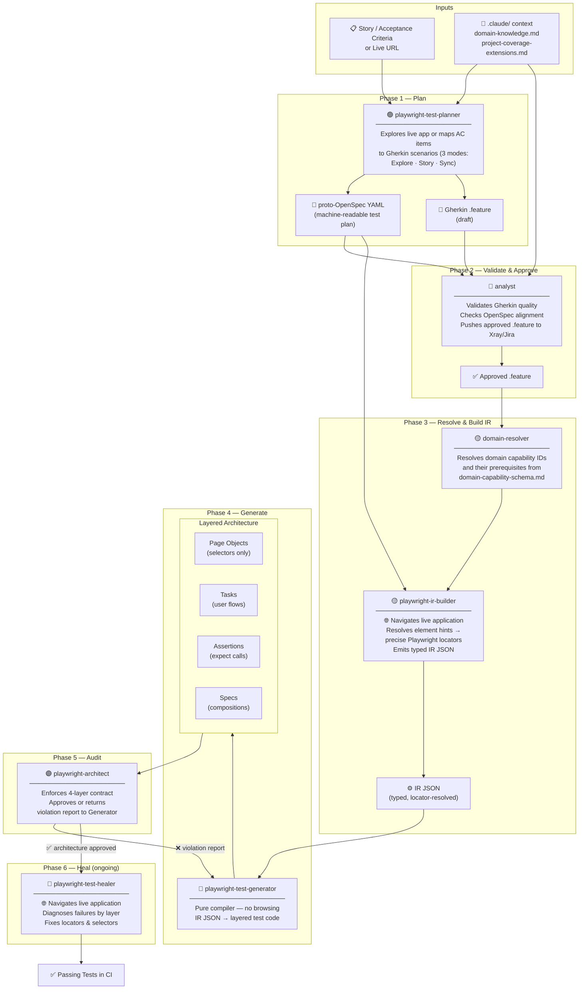

# Playwright Automation Framework — Proxima RMS

## 1. Overview

This is the UI end-to-end test automation framework for **Proxima RMS**, the Revenue Management System used across Norwegian Cruise Line's three brands: **NCL**, **OCEANIA**, and **REGENT**.

The framework is built on **Playwright** with **TypeScript** and integrates the corporate [`@norwegian-cruise-line/ai-playwright-sdk`](https://github.com/norwegian-cruise-line/ai-playwright-sdk) to support both human-authored tests and an **AI agentic pipeline** for autonomous test generation, healing, and auditing.

---

## 2. Architecture

### 2.1 Layered Test Infrastructure

```
playwright-automation/
├── .claude/                         # AI agent context (see Section 6)
│   ├── agents/                      # ← symlink → SDK agents
│   ├── skills/                      # ← symlink → SDK skills
│   ├── env-schema.md                # ← symlink → SDK
│   ├── gherkin-conventions.md       # ← symlink → SDK
│   ├── openspec-schema.md           # ← symlink → SDK
│   ├── domain-capability-schema.md  # ← symlink → SDK
│   ├── domain-knowledge.md          # Project-specific domain rules
│   └── project-coverage-extensions.md  # RMS coverage rules
├── fixtures/
│   ├── baseFixture.ts               # Custom Playwright fixtures (SDK-backed)
│   ├── credentials.ts               # Brand/role credential mapping (typed)
│   └── auth_{BRAND}_{ROLE}.json     # Stored Okta session (generated, git-ignored)
├── locators/
│   ├── index.ts                     # Typed locator registry (PageName, LocatorKey<P>)
│   ├── dashboard.ts
│   ├── pricing.ts
│   └── ...                          # One file per page/component
├── tests/
│   └── *.spec.ts                    # Test suites (17 files, 120 tests)
├── utils/
│   ├── actions.ts                   # Typed reusable UI actions & verifications
│   └── setup-symlinks.cjs           # Postinstall: wires .claude/ symlinks from SDK
├── global-setup.ts                  # Okta auth + allure-results cleanup
├── playwright.config.ts             # SDK-backed config (createBaseConfig)
├── tsconfig.json
└── package.json
```

### 2.2 Type-Safe Locator Registry

All UI selectors are centralized in `locators/` and exposed through a typed registry:

```typescript
// Compile-time safety — typos in page name or locator key are caught immediately
await verifyText(page, 'dashboard', 'summary_flex_headers', 'Gross revenue...');
//                      ↑ PageName   ↑ LocatorKey<'dashboard'>
```

The `PageName` and `LocatorKey<P>` generics in `locators/index.ts` provide full IDE autocomplete for every locator in the project.

### 2.3 SDK Integration

`baseFixture.ts` imports `test` from the SDK instead of `@playwright/test` directly:

```typescript
import { test as base } from '@norwegian-cruise-line/ai-playwright-sdk';
```

This wires in the SDK's plugin lifecycle (BrowserStack session management, Allure attachment hooks) while all custom action fixtures remain unchanged.

---

## 3. Multi-Brand & Multi-Role Execution

Tests are parameterized by **brand** (`NCL` | `OCEANIA` | `REGENT`) and **role** (`admin` | `manager` | `analyst`) via environment variables. Tags on each test control which brand+role combinations it applies to:

```typescript
test.describe('Dashboard @regression @NCL-admin @OCEANIA-admin @REGENT-admin', () => { ... });
```

This produces **9 independent execution contexts** (3 brands × 3 roles), each with its own:
- Okta session (`fixtures/auth_{BRAND}_{ROLE}.json`)
- Docker Compose service (`docker-compose-ui.yml`)

---

## 4. Installation & Setup

### 4.1 Prerequisites

- Node.js (LTS)
- `NODE_AUTH_TOKEN` — GitHub Packages token for the private SDK (`@norwegian-cruise-line` scope)
- Okta credentials for the target brand/role combination

### 4.2 Install Dependencies

```bash
cd playwright-automation
npm install
```

`npm install` automatically runs `postinstall`, which:
1. Installs all dependencies (including `@norwegian-cruise-line/ai-playwright-sdk`)
2. Runs `utils/setup-symlinks.cjs` to wire `.claude/` symlinks from the SDK

### 4.3 Install Playwright Browsers

```bash
npx playwright install chromium
```

### 4.4 Configure Environment

Create `playwright-automation/.env` (git-ignored):

```bash
# Target environment
BASE_URL=http://qa1-rms.nclh.io/

# Execution context
BRAND=NCL
ROLE=admin

# Okta credentials — fill in the brand/role combination you're running
OKTA_USERNAME_NCL_ADMIN=
OKTA_PASSWORD_NCL_ADMIN=
OKTA_SQ_NCL_ADMIN=

# Add other brand/role credentials as needed
# OKTA_USERNAME_NCL_MANAGER=
# OKTA_PASSWORD_NCL_MANAGER=
# ...
```

`BRAND` and `ROLE` in `.env` set the default. They can be overridden at the command line.

---

## 5. Running Tests

### Single brand/role

```bash
BRAND=NCL ROLE=admin npx playwright test --grep @NCL-admin
```

### By test tier

```bash
npm run sanity       # @sanity tests
npm run regression   # @regression tests
```

### All brand/role combinations (via Docker)

```bash
docker compose -f docker-compose-ui.yml up --build
```

Each Docker service maps to one brand+role pair and runs the matching grep tag automatically.

### Specific test

```bash
BRAND=NCL ROLE=admin npx playwright test --grep "verify summary flex headers"
```

### Type-check without running tests

```bash
npm run typecheck
```

---

## 6. AI Agentic Pipeline

The `.claude/` directory wires this project into the SDK's **agentic test pipeline**. After `npm install`, the following agents are available in your AI coding environment.

### Pipeline Overview



### Agent Reference

| Agent | Phase | Browses App? | Description |
|---|---|---|---|
| `playwright-test-planner` | 1 | ✅ Yes | Explores live app or maps AC to Gherkin + OpenSpec YAML |
| `analyst` | 2 | No | Validates Gherkin, checks OpenSpec alignment, pushes to Xray/Jira |
| `domain-resolver` | 3 | No | Resolves domain capability IDs and prerequisites |
| `playwright-ir-builder` | 3 | ✅ Yes | Resolves element hints to precise locators, emits IR JSON |
| `playwright-test-generator` | 4 | No | Compiles IR JSON into layered Page Objects / Tasks / Assertions / Specs |
| `playwright-architect` | 5 | No | Audits layered contract — approves or rejects with violation report |
| `playwright-test-healer` | 6 | ✅ Yes | Diagnoses failures by architectural layer, fixes broken locators |

### Supporting Skills

Skills are invoked by agents automatically — they are not called directly by engineers.

| Skill | Used by |
|---|---|
| `consult-domain-knowledge` | Planner, Analyst — loads RMS domain rules before generating scenarios |
| `derive-scenario-coverage` | Planner — derives negatives, boundaries, and edge cases from happy paths |
| `parse-business-rules` | Planner — converts free-form AC into structured scenario records |
| `write-gherkin` | Planner — generates valid declarative `.feature` files |
| `validate-gherkin` | Analyst — enforces Gherkin quality rules |
| `validate-openspec` | IR Builder — verifies OpenSpec structural integrity before compilation |
| `check-openspec-alignment` | Analyst — ensures approved Gherkin still matches the OpenSpec |
| `verify-requirements-coverage` | Analyst — confirms every AC item has a covering scenario |
| `audit-architecture` | Architect — enforces the 4-layer Page Object contract |

### Project-specific AI context

| File | Purpose |
|---|---|
| `.claude/domain-knowledge.md` | 13 confirmed domain rules covering auth, dashboard, pricing, VDD, saved views, config, performance |
| `.claude/project-coverage-extensions.md` | RMS-specific coverage rules: negative triggers, edge case dimensions (brand × role × action state), tagging requirements |

These files seed the Planner and Analyst with Proxima RMS domain knowledge so generated scenarios reflect real business logic — not generic patterns.

### Symlink maintenance

`.claude/agents`, `.claude/skills`, and the schema files are **symlinks** into `node_modules/@norwegian-cruise-line/ai-playwright-sdk/.claude/`. They are recreated automatically on every `npm install` via the `postinstall` script. Never commit resolved symlink content — commit only the symlink itself.

---

## 7. Authentication Flow

Authentication runs once per execution in `global-setup.ts`:

1. Clears `allure-results/` from the previous run
2. Reads `BRAND` + `ROLE` from environment
3. Resolves Okta credentials from `fixtures/credentials.ts`
4. Launches a headless browser, logs in via `nclh.okta.com`
5. Navigates to `{BASE_URL}/dashboard` to validate the session
6. Saves browser storage state to `fixtures/auth_{BRAND}_{ROLE}.json`

All tests reuse this saved session — no per-test login.

---

## 8. Reporting

| Reporter | Output | When |
|---|---|---|
| `allure-playwright` | `allure-results/` | Every run |
| `html` | `html-report/` | Every run |
| `list` | stdout | Every run |
| Screenshots | `test-results/` | On failure |
| Video | `test-results/` | Retained on failure |
| Trace | `test-results/` | On first retry |

### Generate & open Allure report

```bash
npm run allure:open
```

---

## 9. Writing Tests

Tests import `test` and `expect` from `fixtures/baseFixture.ts` (never directly from `@playwright/test`):

```typescript
import { test } from '../fixtures/baseFixture';
import { verifyText, verifyVisibility, actionClick } from '../utils/actions';

test.describe('My feature @regression @NCL-admin', () => {
  test('verify component is visible [C1234567]', async ({ page }) => {
    await page.goto('/dashboard');
    await page.waitForLoadState('networkidle');
    await verifyVisibility(page, 'dashboard', 'summary_flex_headers');
    await verifyText(page, 'dashboard', 'summary_flex_headers', 'Expected text', { index: 0 });
  });
});
```

### Action utilities (`utils/actions.ts`)

| Function | Signature |
|---|---|
| `actionClick` | `(page, pageName, key, options?)` |
| `typeText` | `(page, pageName, key, value)` |
| `verifyText` | `(page, pageName, key, expected, options?)` |
| `verifyAllTexts` | `(page, pageName, key, expectedList, options?)` |
| `verifyVisibility` | `(page, pageName, key, shouldBeVisible?, options?)` |
| `verifyAttribute` | `(page, pageName, key, attributeName, expectedValue)` |
| `verifyUrl` | `(page, expectedValue)` |
| `writeTextInLocator` | `(page, pageName, key, text, options?)` |
| `verifyElementCount` | `(page, pageName, key, expectedCount)` |

All functions are fully typed — `pageName` and `key` have IDE autocomplete from the locator registry.

---

## 10. Best Practices

- Import `test`/`expect` from `../fixtures/baseFixture` — never from `@playwright/test`
- Use `data-testid` attributes for stable selectors
- Mock API responses (`page.route()`) for any test that asserts data-driven UI values
- Always tag tests with tier (`@sanity` or `@regression`) and brand+role (`@NCL-admin`, etc.)
- Avoid `test.skip` — failing tests must fail loudly
- Add new locators to `locators/<page>.ts` — never use raw selectors in test files
